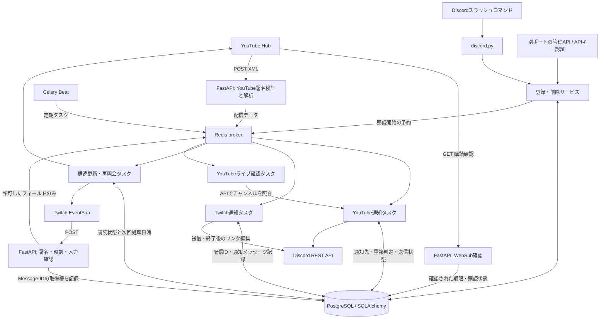

# アーキテクチャ

実装の基準は `73d911da26ec25d7834b50c941551bb4a5aa571a`。ディレクトリ整理後も既存の処理順・状態管理を維持しています。

## 境界と依存方向

`entrypoints` が各アプリを組み立て、`discord` と `admin` が登録サービスを呼びます。登録サービスはDBと各プラットフォームへ依存します。通知タスクはプラットフォームAPI・通知送信・DBに依存し、Celeryアプリはタスクを名前で遅延読込します。このためアプリからタスクへの即時importを避けられます。

既存の `core.i18n` はDBに言語を保存するため `database.models` を参照します。TwitchタスクにはYouTubeタスクの通知先欠落処理への既存依存があります。今回は振る舞いの変更を避けて保持し、`docs/compatibility-evidence.json` に依存グラフを記録しています。

## 配信検知と配送保証の範囲

YouTube WebSubはライブ開始専用イベントではありません。フィード更新に加え、ライブページ確認と動画情報照合を行います。Twitchは `stream.online` / `stream.offline` を受信し、署名・鮮度・Message-IDを確認します。

YouTube/Twitchとも配信を記録してから通知送信する既存方式です。DB記録とDiscordへのHTTP送信は単一トランザクションにならないため、障害時の厳密なexactly-once配送は保証しません。重複抑制を維持しており、途中失敗時の取りこぼしリスクも元実装から保持しています。再設計は本移行の範囲外です。

## 起動入口

- `ojisan.entrypoints.web:app`: Webhook、起動時のDB初期化と必要な購読チェック予約。
- `ojisan.entrypoints.admin:app`: APIキー認証付き管理API。元の画面資産は未収録。
- `python -m ojisan.entrypoints.bot`: Discord接続。importだけでは接続しません。
- `ojisan.workers.celery_app:celery_app`: worker / beat。15タスクの旧登録名を維持。

実運用の複数プロセス、ネットワーク、PostgreSQL特有の挙動はモック検証と分けて評価してください。
