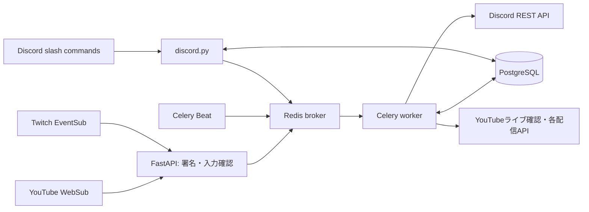

# OJISAN Bot

YouTube・Twitchの配信情報を、登録したDiscordサーバーへ届けるPython製Botです。
このディレクトリは `Kur02007/yt-haisin` のコミット `73d911da26ec25d7834b50c941551bb4a5aa571a` を基にした独立した公開準備用コピーです。元リポジトリ・本番Bot・既存DBには変更を加えていません。ユーザーの明示承認に基づき、新規Publicリポジトリとして公開しています。

## 主な機能

- YouTube WebSubと補助ポーリングによる動画・ライブ情報の検知。
- Twitch EventSubによる開始通知、終了後のアーカイブリンク更新。
- `/add_youtube` `/add_twitch` `/remove_youtube` `/remove_twitch`、登録候補の補完。
- サーバーごとの登録上限（既定はYouTube・Twitch合計20件）。
- `/language` による日本語・英語・韓国語・中国語の切り替え。
- Webhook署名検証、購読更新・再試行、通知の重複抑制。
- 認証付き管理API、実行時のライブポーリング設定。

## 技術とシステム構成

Python 3.12 / FastAPI / SQLAlchemy / PostgreSQL / Celery / Redis / discord.py。
discord.pyは操作用Bot、通知送信・編集はワーカーからDiscord REST APIで行います。



詳しい処理順は [ARCHITECTURE.md](ARCHITECTURE.md)、移行差分は [MIGRATION.md](MIGRATION.md)、検証の範囲は [VERIFICATION.md](VERIFICATION.md) を参照してください。

## ディレクトリ

```text
src/ojisan/
  core/                 設定・言語・実行時設定・ログの秘密値除去
  discord/              スラッシュコマンド・Discordクライアント
  platforms/youtube/    YouTube API・フィード解析・署名・ライブ確認
  platforms/twitch/     Twitch API・EventSub署名と購読管理
  notifications/        Discord REST送信・編集・画像選択
  subscriptions/        チャンネル登録・WebSub購読更新
  database/             既存SQLAlchemyモデルとセッション
  workers/              Celery・通知タスク・定期ポーリング
  admin/                認証・管理API・入力スキーマ
  entrypoints/          Webhook / 管理API / Botの起動入口
tests/                  外部通信をモックした回帰・互換性テスト
docs/                   処理・DB・タスクの設計資料
scripts/                開発用検査
```

## 安全な開発環境・セットアップ

本番の `.env`、DBダンプ、Redis、Discordトークンを開発環境へコピーしないでください。まず外部接続のないテストを実行できます。

```sh
python -m venv .venv
# Windows: .venv\Scripts\activate
# macOS/Linux: source .venv/bin/activate
python -m pip install --upgrade pip
python -m pip install -r requirements-dev.txt -c constraints.txt
python -m pip install --no-deps -e .
python -m pytest -q
python scripts/check_import_graph.py
python scripts/audit_files.py
```

テスト設定は偽の値、SQLiteインメモリDB、Celery memory brokerで固定し、dotenvを無効化します。pytestでは外部HTTPを遮断します。検証に使った依存バージョンは `constraints.txt` に記録しています。これはWindows/Python 3.12での解決結果であり、LinuxでのDockerビルドは別途確認が必要です。

## ローカルサービスの起動

テスト用Botを別途作成してから `.env.example` を `.env` へコピーし、空欄を埋めます。パスワード・APIキーは自分の開発用値を設定します。`DATABASE_URL` は `postgresql://ユーザー:URLエンコードしたパスワード@db:5432/DB名` の形式です。

```sh
python scripts/preflight.py
docker compose config --quiet
docker compose up --build
```

このComposeは独立した `ojisan-development` プロジェクト・新規ボリュームを使います。Webhookは `127.0.0.1:8195`、管理APIは `127.0.0.1:8196`。実際の購読確認には、開発環境へ到達できる専用の公開URLが必要です。TwitchはHTTPS・443番ポートが必要で、4つのTwitch設定がすべて揃ったときのみ有効です。

コンテナを使わない場合、開発用PostgreSQL/Redisの接続先を設定した別々の端末で起動します。

```sh
uvicorn ojisan.entrypoints.web:app --host 127.0.0.1 --port 8195
uvicorn ojisan.entrypoints.admin:app --host 127.0.0.1 --port 8196
celery -A ojisan.workers.celery_app:celery_app worker --loglevel=info
celery -A ojisan.workers.celery_app:celery_app beat --loglevel=info
python -m ojisan.entrypoints.bot
```

Celeryワーカーの運用環境はLinuxコンテナを想定します。Windowsではモックテストを優先してください。

## 運用・互換性

DBモデルのテーブル・列・制約定義と、15個の既存Celeryタスク名を保持しています。ただし実DBの移行・本番ローリング更新は未実施です。既存キューと並行稼働させず、複製したDBと専用Redisで検証してください。`create_all()` は既存テーブルの列変更を行うマイグレーションではありません。

元スナップショットに管理画面の `static/` が含まれないため、このコピーは管理APIのみ利用可能です。元で参照されているSQLマイグレーションファイルも含まれていません。本番DB互換性の最終確認にはそのファイルと実スキーマの確認が必要です。

公開前の注意・署名設定・ログ管理は [SECURITY.md](SECURITY.md) を確認してください。

## ライセンス

プロジェクトのライセンスは未設定です。公開前に権利を確認し、採用するライセンスを決定してください。依存パッケージにはそれぞれのライセンスが適用されます。
