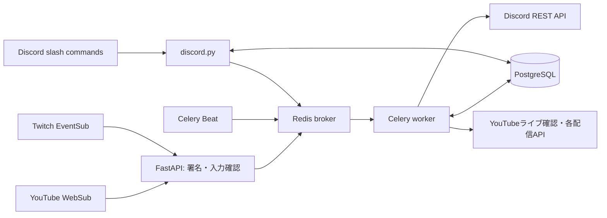

# OJISAN Bot

YouTube・Twitchの配信情報を、登録したDiscordサーバーへ届けるPython製Botです。

このリポジトリは、サービスをより安心して使用してもらうために公開しています。

> [!IMPORTANT]
> このBotのコードは、一部をAIを用いて作成しています。
> 2年以上のテスト運用を行っていますが、現在も欠陥（不具合）が残っています。通知の遅れ・漏れなどが起きる場合があることをご了承ください。

## 主な機能

- YouTube WebSubと補助ポーリングによる動画・ライブ情報の検知。
- Twitch EventSubによる開始通知、終了後のアーカイブリンク更新。
- `/add_youtube` `/add_twitch` `/remove_youtube` `/remove_twitch`、登録候補の補完。
- サーバーごとの登録上限（YouTube・Twitch合計20件）。
- `/language` による日本語・英語・韓国語・中国語の切り替え。
- Webhook署名検証、購読更新・再試行、通知の重複抑制。

## 使い方

### 1. Botをサーバーに追加する

Botをサーバーへ招待し、通知を送りたいチャンネルで次の権限を許可してください。

- チャンネルを見る
- メッセージを送信
- 埋め込みリンク
- `@everyone`・`@here`・すべてのロールへのメンション（通知でメンションを飛ばす場合）

コマンドはすべてサーバー内で実行します。DMでは使えません。

### 2. 通知を登録する

**YouTube**

```text
/add_youtube url:<チャンネルURL・@ハンドル・チャンネルID> channel:<通知先> message:<通知文>
```

**Twitch**

```text
/add_twitch url:<チャンネルURL・チャンネル名> channel:<通知先> message:<通知文>
```

- `channel` を省略すると、コマンドを実行したチャンネルが通知先になります。
- `message` を省略すると、既定の通知文になります。
- 登録済みのチャンネルをもう一度登録すると、通知先・通知文が上書きされます。
- 登録上限はサーバーごとにYouTube・Twitch合計20件です。

### 3. 通知文をカスタマイズする

`message` には次の文字を入れられます。通知時に実際の内容へ置き換わります。

| 入力 | 置き換わる内容 |
| --- | --- |
| `{name}` | 配信者名 |
| `{title}` | 動画・配信のタイトル |
| `{link}` | 動画・配信のURL |

例：`/add_youtube url:https://www.youtube.com/@example message:{name}さんの配信が始まりました！ {link}`

通知文に `@everyone` または `@here` が含まれていない場合は、末尾に `@everyone` が自動で付きます。

### 4. 届く通知

**YouTube**

- 動画の公開
- ライブ配信の予約・開始
- プレミア公開の予約・開始
- メンバー限定のものは 🔒 付きで通知されます

**Twitch**

- 配信開始時に通知します
- 配信終了後、通知内のリンクがアーカイブ（VOD）へ差し替わります（アーカイブが公開されていない場合は差し替わりません）

### 5. 登録を解除する

```text
/remove_youtube channel:<登録済みチャンネル>
/remove_twitch channel:<登録済みチャンネル>
```

入力欄に、このサーバーで登録済みのチャンネルが候補として表示されます。

### 6. 言語を変更する

```text
/language language:<日本語 / English / 한국어 / 中文>
```

Botの応答と既定の通知文が、選んだ言語に切り替わります（サーバー単位の設定です）。

### コマンド一覧

| コマンド | 内容 |
| --- | --- |
| `/add_youtube` | YouTubeチャンネルの通知を登録・更新 |
| `/add_twitch` | Twitchチャンネルの配信開始通知を登録・更新 |
| `/remove_youtube` | YouTubeチャンネルの登録を削除 |
| `/remove_twitch` | Twitchチャンネルの登録を削除 |
| `/language` | 応答・通知の言語を設定 |

### 補足

- 登録・削除の成功メッセージは、10秒後に自動で消えます。
- コマンドを実行できるメンバーは、Discordの「サーバー設定 → 連携サービス」から制限できます。

## 技術とシステム構成

Python 3.12 / FastAPI / SQLAlchemy / PostgreSQL / Celery / Redis / discord.py。
discord.pyは操作用Bot、通知送信・編集はワーカーからDiscord REST APIで行います。



詳しい処理順は [ARCHITECTURE.md](ARCHITECTURE.md)、移行差分は [MIGRATION.md](MIGRATION.md) を参照してください。

## ディレクトリ

```text
src/ojisan/
  core/                 設定・言語・実行時設定・ログの秘密値除去
  discord/              スラッシュコマンド・Discordクライアント
  platforms/youtube/    YouTube API・フィード解析・署名・ライブ確認
  platforms/twitch/     Twitch API・EventSub署名と購読管理
  notifications/        Discord REST送信・編集・画像選択
  subscriptions/        チャンネル登録・WebSub購読更新
  database/             既存SQLAlchemyモデルとセッション
  workers/              Celery・通知タスク・定期ポーリング
  admin/                認証・管理API・入力スキーマ
  entrypoints/          Webhook / 管理API / Botの起動入口
tests/                  外部通信をモックした回帰・互換性テスト
docs/                   処理・DB・タスクの設計資料
scripts/                開発用検査
```

## セキュリティ

Webhookの署名検証やログからの秘密値除去などを行っています。詳細は [SECURITY.md](SECURITY.md) を参照してください。

## ライセンス

プロジェクトのライセンスは未設定です。依存パッケージにはそれぞれのライセンスが適用されます。
