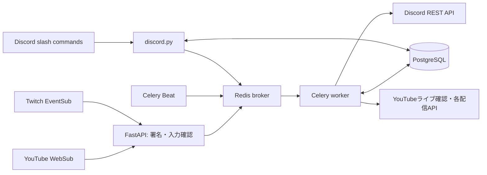

# OJISAN Bot

YouTube・Twitchの配信情報を、登録したDiscordサーバーへ届けるPython製Botです。

このリポジトリは、サービスをより安心して使用してもらうために公開しています。

公式サイト（Botの追加はこちら）：https://odd-haze-b36f.ku1o.workers.dev/

> [!IMPORTANT]
> このBotのコードは、一部をAIを用いて作成しています。
> 2年以上のテスト運用を行っていますが、現在も欠陥（不具合）が残っています。通知の遅れ・漏れなどが起きる場合があることをご了承ください。

## 主な機能

- YouTube WebSubと補助ポーリングによる動画・ライブ情報の検知。
- Twitch EventSubによる開始通知、終了後のアーカイブリンク更新。
- `/add_youtube` `/add_twitch` `/remove_youtube` `/remove_twitch`、登録候補の補完。
- サーバーごとの登録上限（YouTube・Twitch合計20件）。
- `/language` による日本語・英語・韓国語・中国語の切り替え。
- Webhook署名検証、購読更新・再試行、通知の重複抑制。

## 使い方

### 1. Botをサーバーに追加する

[公式サイト](https://odd-haze-b36f.ku1o.workers.dev/)の「Discordに追加」から、Botをサーバーへ招待します。招待にはサーバーの「サーバー管理」権限が必要です。

招待時に、Botへ次の4つの権限が付与されます。通知に必要な最小限で、管理者権限やメッセージの削除・ロールの管理などは含みません。招待画面でチェックを外すこともできます。

| 権限 | 必要な理由 |
| --- | --- |
| チャンネルを見る | 通知先チャンネルにアクセスするため |
| メッセージを送信 | 通知を投稿するため |
| 埋め込みリンク | サムネイル・タイトル付きの通知カードを表示するため |
| `@everyone`・`@here`・すべてのロールへのメンション | 通知でメンションを飛ばすため（下記「メンションについて」参照） |

チャンネルごとに権限を制限している場合（非公開チャンネルなど）は、通知先チャンネルの設定でも上記の権限をBotに許可してください。

Twitchの登録時は、Botが通知先に投稿できるかを先に確認します。権限が足りない場合は登録されず、必要な権限が案内されます。

コマンドはすべてサーバー内で実行します。DMでは使えません。

### 2. 通知を登録する

**YouTube**

```text
/add_youtube url:<チャンネル> channel:<通知先> message:<通知文>
```

`url` には次のどれかを入力します。

| 形式 | 例 |
| --- | --- |
| ハンドルURL | `https://www.youtube.com/@example` |
| ハンドル | `@example` |
| チャンネルURL | `https://www.youtube.com/channel/UCxxxxxxxxxxxxxxxxxxxxxx` |
| チャンネルID | `UCxxxxxxxxxxxxxxxxxxxxxx` |

`/c/〜` や `/user/〜` 形式の古いURLには対応していません。チャンネルページを開き、`@` から始まるハンドルを確認して入力してください。

**Twitch**

```text
/add_twitch url:<チャンネル> channel:<通知先> message:<通知文>
```

`url` には `https://www.twitch.tv/example` のようなチャンネルURL、または `example` のようなチャンネル名を入力します。

**共通のルール**

- `channel` を省略すると、コマンドを実行したチャンネルが通知先になります。
- `message` を省略すると、既定の通知文（例：「🔴 **名前** が配信を開始しました！」）になります。
- 登録済みのチャンネルをもう一度登録すると、通知先と通知文が上書きされます。`message` を省略した場合、通知文は変更されません。
- 同じチャンネルを別々のサーバーで登録しても、それぞれのサーバーに通知が届きます。
- 登録・解除の成功メッセージは、チャンネルを散らかさないよう10秒後に自動で消えます。

### 3. 通知文をカスタマイズする

`message` には次の文字を入れられます。通知時に実際の内容へ置き換わります。

| 入力 | 置き換わる内容 |
| --- | --- |
| `{name}` | 配信者名 |
| `{title}` | 動画・配信のタイトル |
| `{link}` | 動画・配信のURL |

例：

```text
/add_youtube url:@example message:{name}さんの配信が始まりました！ {link}
```

通知文の下には、タイトル・サムネイル・リンク付きの埋め込みカードが表示されます。

### 4. メンションについて

通知には、必ずメンションが付きます。

- 通知文に `@everyone` も `@here` も含まれていない場合、末尾に `@everyone` が自動で付きます。既定の通知文でも同じです。
- 通知文に `@here` を入れると、`@everyone` は付かず `@here` のみになります。
- Botに「`@everyone`・`@here`・すべてのロールへのメンション」権限がない場合、文字としては表示されますが、通知音は鳴りません。

メンションを鳴らしたくない場合は、招待画面でこの権限のチェックを外すか、あとからBotのロールの権限をオフにしてください。

### 5. 届く通知

**YouTube**

| 通知 | 内容 |
| --- | --- |
| 📹 動画 | 動画が投稿されたとき |
| 📅 配信予約 | ライブ配信の予約枠が作られたとき（開始予定時刻つき） |
| 🔴 配信開始 | ライブ配信が始まったとき |
| 🎬 プレミア公開 | プレミア公開の予約・開始 |

- メンバー限定のものは 🔒 付きで通知されます。
- メンバー限定かどうかは自動判定のため、通知のあとに「メンバー限定の可能性があります」という追記が届くことがあります。この判定は推測であり、外れる場合があります。
- YouTube側の通知の仕組み上、反映までに時間がかかる場合があります。そのため、定期的な確認でも取りこぼしを補っています。

**Twitch**

- 配信開始時に、プレビュー画像つきで通知します。
- 配信終了後、通知のリンクとサムネイルがアーカイブ（VOD）へ差し替わり、タイトルに「【アーカイブ】」、配信時間が追加されます。
- アーカイブが見つからない場合（配信者がアーカイブを保存していない等）は差し替わりません。

同じ動画・配信について、通知が重複して届かないよう制御しています。

### 6. 登録を解除する

```text
/remove_youtube channel:<登録済みチャンネル>
/remove_twitch channel:<登録済みチャンネル>
```

入力欄に、このサーバーで登録済みのチャンネルが候補として表示されます。候補から選ぶほか、チャンネルID・チャンネル名・URLを直接入力することもできます。

解除すると、このサーバーの残り登録数（例：`3/20`）が表示されます。解除してもほかのサーバーの登録には影響しません。

### 7. 言語を変更する

```text
/language language:<日本語 / English / 한국어 / 中文>
```

Botの応答と既定の通知文が、選んだ言語に切り替わります。設定はサーバーごとに保存され、未設定の場合は日本語です。自分で設定した通知文（`message`）は翻訳されません。

### コマンド一覧

| コマンド | 内容 |
| --- | --- |
| `/add_youtube` | YouTubeチャンネルの通知を登録・更新 |
| `/add_twitch` | Twitchチャンネルの配信開始通知を登録・更新 |
| `/remove_youtube` | YouTubeチャンネルの登録を削除 |
| `/remove_twitch` | Twitchチャンネルの登録を削除 |
| `/language` | 応答・通知の言語を設定 |

コマンドを実行できるメンバーは、Discordの「サーバー設定 → 連携サービス → OJISAN」から制限できます。

### うまくいかないとき

| 表示・症状 | 対処 |
| --- | --- |
| 登録上限に達したと表示される | このサーバーの登録がYouTube・Twitch合計20件に達しています。不要な登録を解除してください。 |
| チャンネルが見つからないと表示される | ハンドルやチャンネル名の綴りを確認してください。YouTubeは `@` から始まるハンドルで入力すると確実です。 |
| 投稿権限がないと表示される | 「1. Botをサーバーに追加する」の権限を、通知先チャンネルで許可してください。 |
| Twitchで「EventSub購読の作成に失敗しました」と表示される | 登録自体は保存されています。1時間ごとの自動確認で再試行されます。 |
| しばらく待っても通知が来ない | 通知先チャンネルの権限を確認してください。権限に問題がない場合は、Bot側の不具合の可能性があります。 |
| システムエラーと表示される | Bot側の問題です。時間をおいて再度お試しください。 |

解決しない場合は、下記「お問い合わせ」からご連絡ください。

## お問い合わせ

使い方がわからないときや、不具合を見つけたときは、開発者のDiscordまでご連絡ください。

- Discord：`cat112`

ご連絡の際は、次の内容があると対応がスムーズです。

- 使ったコマンドと、表示されたメッセージ
- 登録しているYouTube・Twitchのチャンネル
- 起きた日時

## 技術とシステム構成

Python 3.12 / FastAPI / SQLAlchemy / PostgreSQL / Celery / Redis / discord.py。
discord.pyは操作用Bot、通知送信・編集はワーカーからDiscord REST APIで行います。



詳しい処理順は [ARCHITECTURE.md](ARCHITECTURE.md)、移行差分は [MIGRATION.md](MIGRATION.md) を参照してください。

## ディレクトリ

```text
src/ojisan/
  core/                 設定・言語・実行時設定・ログの秘密値除去
  discord/              スラッシュコマンド・Discordクライアント
  platforms/youtube/    YouTube API・フィード解析・署名・ライブ確認
  platforms/twitch/     Twitch API・EventSub署名と購読管理
  notifications/        Discord REST送信・編集・画像選択
  subscriptions/        チャンネル登録・WebSub購読更新
  database/             既存SQLAlchemyモデルとセッション
  workers/              Celery・通知タスク・定期ポーリング
  admin/                認証・管理API・入力スキーマ
  entrypoints/          Webhook / 管理API / Botの起動入口
tests/                  外部通信をモックした回帰・互換性テスト
docs/                   処理・DB・タスクの設計資料
scripts/                開発用検査
```

## セキュリティ

Webhookの署名検証やログからの秘密値除去などを行っています。詳細は [SECURITY.md](SECURITY.md) を参照してください。

## ライセンス

このリポジトリは、サービスの安全性を確認していただくための閲覧を目的として公開しています。オープンソースライセンスは付与していないため、無断での複製・再配布・改変はご遠慮ください。

依存パッケージには、それぞれのライセンスが適用されます。
