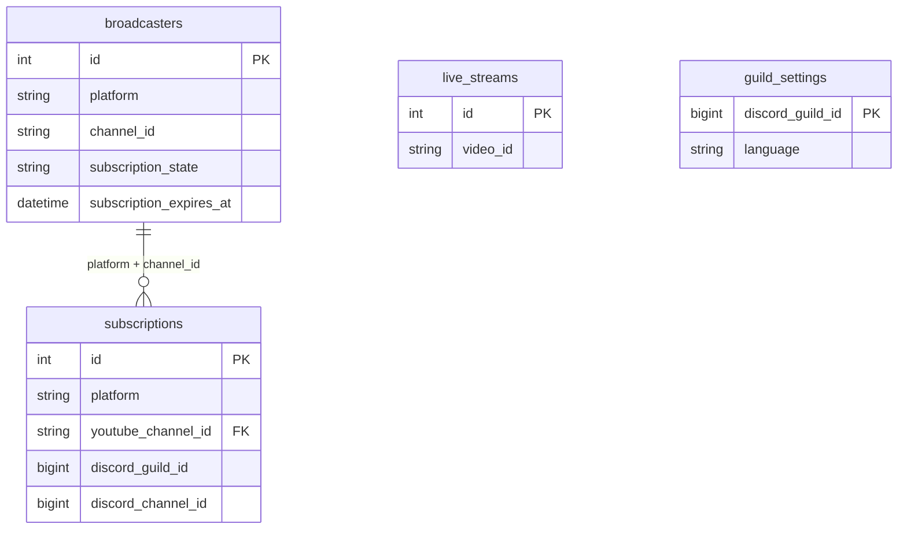

# データベース互換性

`database/models.py` の全class/function定義は、元の `models.py` とAST比較で一致しています。import以外のモデル定義・初期化処理は変更していません。

図は主要な関係のみです。YouTube/Twitch共用の `subscriptions.youtube_channel_id` は互換性のため改名しません。`live_streams`、`twitch_eventsub_messages`、`twitch_stream_notifications`、`app_settings`、`notification_logs` 等の完全な列・制約はモデルを正とします。

SQLiteでのテストはPostgreSQLでのロック、競合、トランザクション障害、本番の実スキーマを保証しません。既存DBへ接続しての検証は行っていません。元ソースで参照するSQLマイグレーションは提供スナップショットに含まれていないため、既存DBの移行手順は未確定です。
